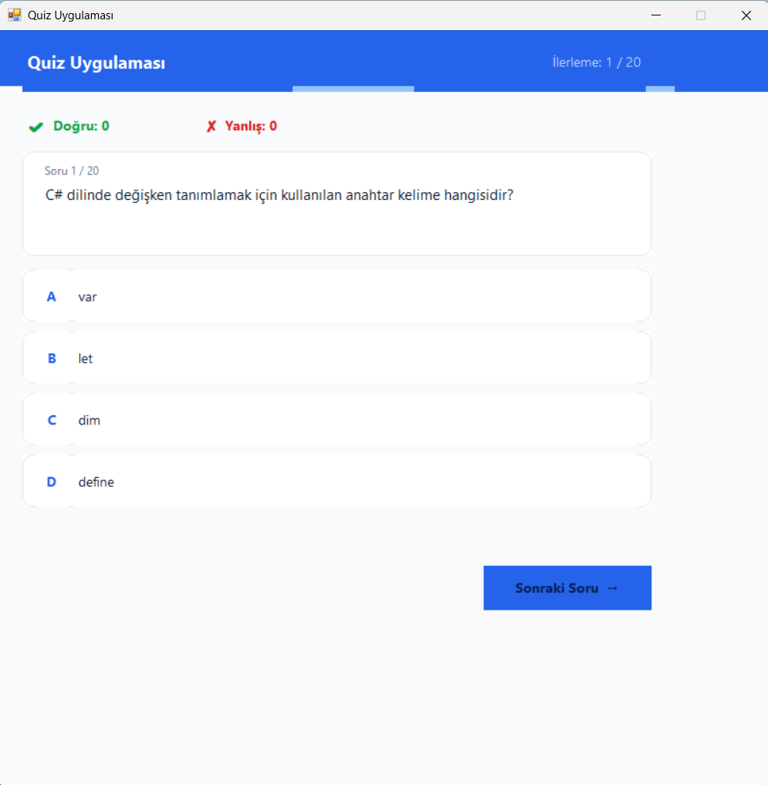
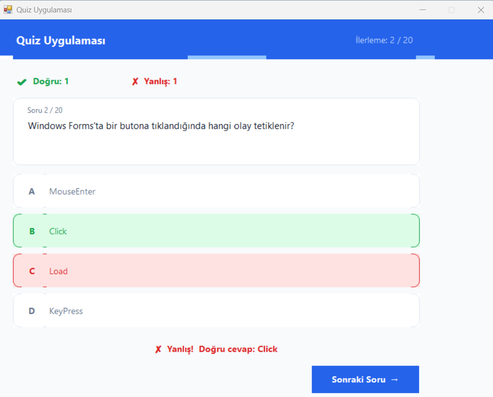
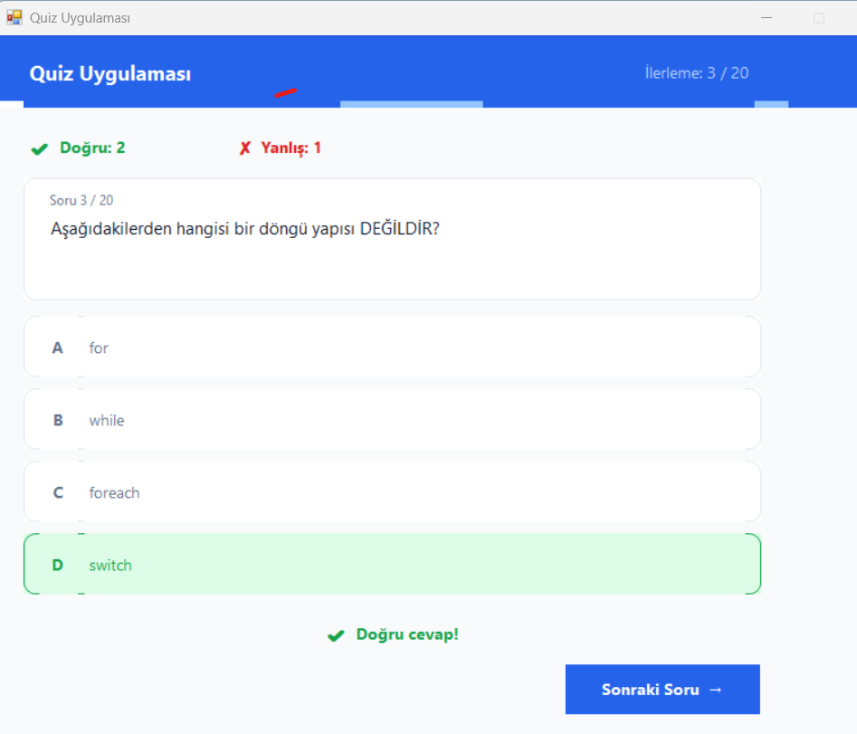
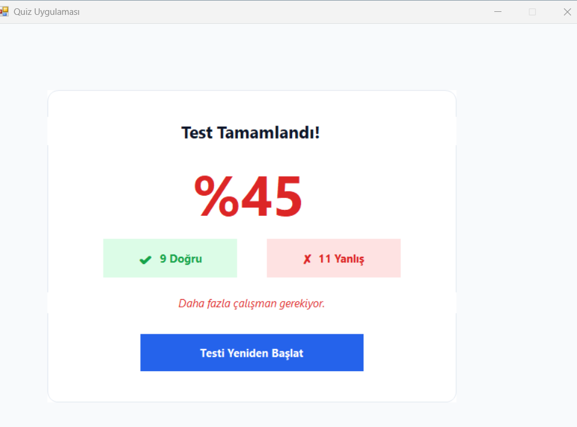

# C# Quiz Uygulaması

C# ve Windows Forms kullanılarak geliştirilmiş, çoktan seçmeli sorularla kullanıcıların programlama bilgilerini test etmelerini sağlayan bir masaüstü uygulamasıdır.

## Özellikler

- 20 soruluk çoktan seçmeli test
- Doğru ve yanlış cevapların takibi
- Seçilen cevaba göre anlık geri bildirim
- İlerleme göstergesi
- Test sonunda başarı yüzdesi ve sonuç ekranı
- Testi yeniden başlatma

## Kullanılan Teknolojiler

- C#
- .NET Framework
- Windows Forms
- Visual Studio

## Ekran Görüntüleri

### Quiz ekranı

### Yanlış cevap

### Doğru cevap

### Sonuç ekranı

## Çalıştırma

1. Depoyu bilgisayarına indir veya klonla.
2. `QuizUygulamasi.csproj` dosyasını Visual Studio ile aç.
3. Projeyi derle ve çalıştır.

## Amaç

Bu proje, C# programlama ve Windows Forms ile masaüstü uygulaması geliştirme konularındaki pratik çalışmalarımın bir parçasıdır.
